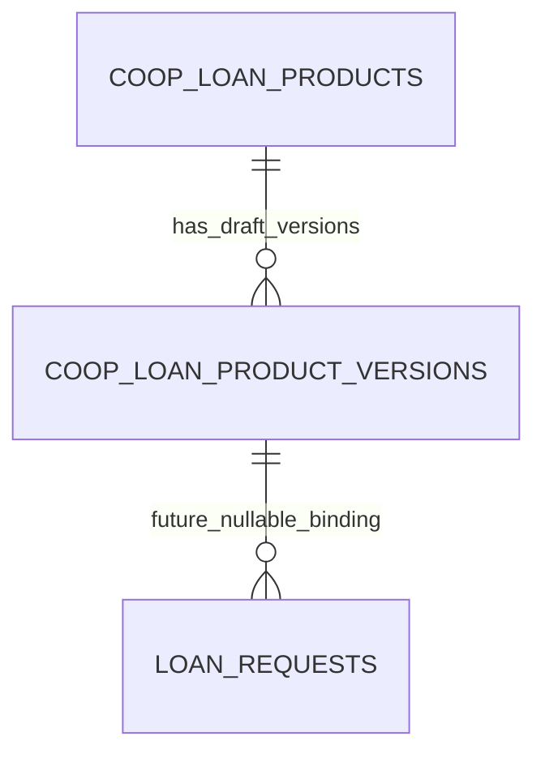

# Loan product configuration contract

Owner decision, 21 October 2026: configure products before accepting new applications. Existing two-guarantor and 10% monthly repayment values are legacy implementation behavior, not approved cooperative policy.

## Current implemented boundary

`LoanProductService` stores draft products and append-only draft versions. No publication or activation operation exists. Product status accepts only `draft` and `inactive`. Draft configuration is candidate information, not executable or validated product policy. It cannot authorize an application. The service never updates a stored version; database administrators must preserve version rows and their content hashes.

Both `POST auth_api/api/loans/request.php` and `POST auth_api/api/admin/manual-loan.php` return HTTP 409 with the configuration-required message before performing any financial calculation or insertion. Supplying `product_version_id`, a legacy approval flag, or changing database status cannot enable the unfinished flow. Existing loan reads and authenticated guarantor responses remain available. No existing application is assigned guessed product terms.

`GET auth_api/api/loans/products.php` requires a member JWT and returns:

```json
{"success":true,"data":{"applications_enabled":false,"code":"LOAN_PRODUCT_SETUP_REQUIRED","message":"Loan product configuration is required before new applications can be created. Ask an administrator to complete and approve the product rules.","products":[]}}
```

Creation clients should show this message and disable submission. A future request contract includes `product_version_id`; member ownership remains bound to JWT identity. The current response is an explicit setup boundary, not a completed application journey.

## Proposed rule categories requiring owner decisions

- Identity: distinguish `member_self_service`, `staff_assisted_member`, and `staff_assisted_nonmember`. A nonmember needs a stable borrower record separate from `tblemployees`, not a made-up CoopID. Assisted applications must retain the member/borrower and authenticated staff actor separately.
- Eligibility: permitted member categories/status, minimum membership duration where applicable, nonmember eligibility and required evidence.
- Calculation: principal limits, duration and repayment frequency, supported interest/service-charge method and basis, fee amount/basis/timing/refundability, exact rounding rule, installment schedule and remainder treatment. No percentage, duration or rate is preselected.
- Guarantees: required count, guaranteed amount/exposure basis, member eligibility and exposure limits, expiry and withdrawal policy. **Nonmember borrowers require their own configured guarantor eligibility rules per product**; do not silently reuse member-borrower rules.
- Documents and decisions: required document categories, acceptance evidence, approval stages, disbursement checks/channel and terms text.

Before enabling publication, select and implement these rules; validate every required rule; show all material terms, fees, total repayable and schedule; capture borrower acceptance; enforce guarantor eligibility/exposure and configurable count at invitation, consent, approval and disbursement. The current guarantor workflow remains legacy and must not be treated as implementation of these new rules.

## Comprehensive calculation scope to confirm and implement

The owner explicitly approved these methods: interest-free, flat interest, reducing balance with equal installments, reducing balance with equal principal, interest-only with final principal, and a manually reviewed installment schedule. Rates, fees and timing remain configurable per product. This is an implementation backlog, not a restriction to one method and not a claim that draft JSON executes these methods. The brief does not define their formulas, rate bases or policy values. Proposed explicit options for review:

- Charge methods: no interest/charge; flat charge on original principal; reducing balance with equal installments; reducing balance with equal principal; interest-only installments with a final principal balloon; and an explicitly reviewed custom installment schedule.
- Rate definitions: fixed or variable rates where applicable; per-installment, monthly or annual basis; accrual/day-count convention; effective dates and treatment of rate changes. Percentage values require owner configuration.
- Fees: fixed or percentage basis; upfront collection, deduction from proceeds, or financing into principal; payment timing, refundability and inclusion in guarantee exposure.
- Schedules: weekly, fortnightly, monthly, quarterly or explicit due dates; duration; grace/moratorium rules; exact kobo rounding and remainder allocation. Calendar conventions need definition before use.
- Servicing: payment allocation order; partial/prepayments and early settlement; arrears/default handling and any configured penalties; reversals and outstanding-balance calculation. No penalty or compounding is assumed.

For each enabled method, implement independent worked-example tests approved by the owner, exact schedule reconciliation, disclosures of proceeds/charges/total repayable, versioned calculation inputs and configurable guarantee exposure. Unknown methods or incomplete configurations must remain blocked. Nonmember-borrower guarantee eligibility must be configured independently even when the financial formula is shared.

## Version and consent binding

The migration adds nullable application fields `loan_product_version_id`, `product_terms_snapshot`, and `product_terms_hash`. A future enabled application must reference an immutable product version and store the exact resolved terms shown to the borrower. `product_terms_hash` is SHA-256 of the exact snapshot string. Product-bound consent hashing validates this hash and includes both the version ID and snapshot hash, in addition to existing borrower/amount/repayment fields. Material changes require a new immutable snapshot and fresh consent.

Before enabling new applications, every approval/disbursement query must load these fields and require product binding for new applications; old applications need a separately reviewed transition policy. Existing legacy consent hashes retain their format so current reads and responses are preserved.

## Migration and rollback

Apply `database/migrations/20261021_loan_product_drafts.sql` only after backup and isolated staging validation. It is additive and repeatable; it inserts no product/rate/member data. Roll back application code first and retain additive draft/version/snapshot records for audit. The down migration deliberately refuses to remove nonempty draft or bound application data. No migration has been applied to production.

## Minimum remaining calculation decisions

For the approved methods, the remaining initial decisions are: (1) how each configured percentage rate is expressed (per installment/month/year), (2) the rounding convention and which installment absorbs the final kobo remainder, (3) due-date/calendar rules and any grace period, and (4) how fees enter proceeds, total repayable and guaranteed exposure. No day-count accrual, arrears charge, penalty or compounding rule will be inferred. Initial fixed-period schedules can be implemented after these semantics are confirmed; variable accrual and servicing rules remain separate explicit policy.

## Schema-tool verification limits

The database-designer SQL analyzer was run on normalized DDL; its parser omitted several columns and the declared foreign key, so its ERD is incomplete. Candidate rules deliberately use JSON for unapproved draft information and immutable snapshots; this is not a substitute for enforceable operational rule fields. The index optimizer recommended `(product_id, version_number)`, already covered by the unique key, so no duplicate index was added. The migration generator's validation step failed with its own `Table is not JSON serializable` error; the actual repeatable migration is instead verified on isolated MariaDB.



## Implemented pure calculator contract: fixed_period_v1

`libs/services/LoanScheduleCalculator.php` now calculates all six approved methods. This calculator is isolated from publication and application creation: the configuration gate remains closed until product validation, borrower/guarantor rules, fee handling, acceptance evidence and UI are integrated. A calculated schedule is not an approval, disbursement or authenticated manual review.

Every input is explicit. Required common fields are `principal` (nonnegative decimal money string, strictly positive), `method`, `installment_count` (integer), `rounding_mode`, `residual_treatment`, and `fees`. Supported method identifiers are `interest_free`, `flat`, `reducing_equal_installments`, `reducing_equal_principal`, `interest_only_balloon`, and `manual_schedule`.

```json
{
  "principal": "10000.00",
  "method": "reducing_equal_installments",
  "installment_count": 12,
  "rate_basis": "per_installment",
  "rate_per_installment": "0.01",
  "rounding_mode": "half_up",
  "residual_treatment": "adjust_final_installment",
  "fees": {"handling": "none"}
}
```

The example contains test values, not approved product rates or policy. Rate-bearing methods require `rate_basis: per_installment` and a fractional decimal-string `rate_per_installment`: `0.01` means 1% of the applicable principal per numbered installment. Annual, monthly, effective-rate and day-count conversions are rejected rather than inferred. Interest-free and manual methods reject rate fields because they do not consume them. Unknown input fields are rejected so a fee, date or policy cannot appear accepted while being ignored.

Supported explicit rounding modes are `half_up`, `half_even`, `down` (toward zero for these nonnegative amounts), and `up` (away from zero). The only supported residual policy is `adjust_final_installment`. The caller must choose both; neither has a default. Fees currently require exactly `{"handling":"none"}`. Any actual fee, financed fee, deducted fee or unknown handling is rejected. Configured paid/financed fees remain part of the integration backlog and cannot be represented as silently zero.

Calculation semantics:

- Interest-free: divide principal into equal rounded allocations; put the remaining principal in the final installment.
- Flat and interest-only balloon: compute total interest as principal × explicitly per-installment rate × installment count, round this total once under the selected policy, then divide it into equal rounded interest allocations with the remaining interest in the final installment. Flat principal is allocated as for interest-free; balloon principal remains outstanding until the final installment.
- Reducing balance with equal principal: allocate principal as for interest-free. Each installment's interest is the opening outstanding principal × rate, rounded to kobo under the selected policy.
- Reducing balance with equal installments: calculate the standard fixed-period annuity payment P × r × (1+r)^n / ((1+r)^n − 1); for explicitly zero rate use P/n. Round that target payment under the configured policy. Each installment's interest is opening principal × rate, independently rounded to kobo, and the rest reduces principal. The final repayment is the exact remaining principal plus the rounded final interest; it may differ from the preceding target installment.
- Manual schedule: require `schedule` as a list of exactly `installment_count` rows, each containing only explicit `principal` and `interest` money strings, plus explicit `reviewed_total_interest`. Principal allocations must sum exactly to the requested principal, interest allocations to the reviewed total, and outstanding principal must never be negative. These mathematical checks do not prove staff review or authorize the schedule.

All repayments must be positive. Negative amortization, negative allocations, early exhaustion caused by generated rounding, a nonzero final principal, unreconciled charges or DECIMAL(15,2) overflow cause failure. Infeasible tiny-principal/count/rounding combinations are rejected rather than silently changing the chosen method or number of installments.

Output contains decimal strings for principal, total interest and total repayable, plus numbered installments with `opening_principal`, `principal`, `interest`, `repayment`, and `closing_principal`. Each row and the aggregate totals reconcile exactly. It contains no due dates and does not claim that numbered installments represent an actual dated repayment schedule.

Technical bounds are 1–1200 installments and fractional rate strings with up to six integer digits and eighteen decimal places. These bounds prevent resource exhaustion and are not cooperative eligibility/duration/rate policies. BCMath uses scale 40 internally; persisted/output money is converted only through integer minor units and canonical two-decimal strings. No binary floating-point arithmetic is used.

Verification: `php tests/loan_schedule_calculator_test.php` exercises all six methods, every rounding enum, half-even ties, final principal/interest residuals, explicit zero rates, tiny principal, strict configuration rejection, overflow and negative amortization. An independently evaluated Python Decimal annuity oracle checks all twelve interest allocations and the final repayment for the example above: eleven repayments of 888.49, final repayment 888.47, total interest 661.86. These are synthetic worked examples, not product recommendations.

## Admin draft API and retry/audit contract

`api/loan_product_drafts.php` requires an authenticated administrator with a valid numeric trusted staff ID before any database access. Mutations accept POST JSON only and enforce the existing same-origin guard. Actor IDs in request bodies are not accepted. Responses contain `success`, `draft_only: true`, `applications_enabled: false`, and `data`; failures contain `success: false` and a public `message`. Internal database details are never returned.

GET `action=list&page=1&limit=20` returns `{items,page,limit,total}` with product metadata and `version_count`. GET `action=versions&product_id=ID&page=1&limit=20` returns immutable version records with decoded `configuration`, `terms_text`, hash and staff provenance. Page is bounded to 1–10000 and limit to 1–50.

POST `action=create_draft` requires `idempotency_key`, `code`, `name`, `description`. POST `action=save_version` requires `idempotency_key`, integer `product_id`, structured `calculation_inputs`, and nonempty `terms`. The candidate calculation must pass the pure calculator, but remains draft information; it does not establish a publishable product or borrower acceptance. `action=preview` requires only `calculation_inputs`, returns the exact calculation, and does not open a database connection or write an audit record.

Create/save submission keys are scoped by trusted staff actor and action. Identical retries return the same result with `replayed: true`; changed payloads with an existing key return HTTP 409. Database row locking protects concurrent retries. Product/version creation, command result and protected `coop_audit_trail` entry commit together. An audit failure rolls all of them back; nested calls use savepoints and never commit caller transactions. Audit records contain product/version identifiers and content hashes, not member data or full schedules. Apply `20261021_loan_product_commands.sql` after the draft migration. Both down scripts preserve nonempty draft/binding/retry evidence.

Verification includes isolated MariaDB audit-failure rollback and retries, immutable version replay, three concurrent same-key creates, caller rollback, bounded pagination, and real loopback HTTP tests for anonymous/member/malformed-actor rejection, cross-origin rejection, pure preview, unsupported publication and private errors. HTTP tests copy only the endpoint and dependencies into `work/` and use a deliberately failing fixture configuration; no production configuration is opened.

## Current signed guarantor approval policy: owner override

The owner subsequently made uploaded signed guarantor approvals mandatory for online and offline applications. Borrowers, guarantors or authorized staff may upload; upload provenance does not imply that the guarantor authenticated. Authorized staff must accept clean current-terms evidence before a loan can be approved. A staff uploader requires a different staff reviewer; member IDs and staff IDs are separate namespaces and are not compared as if they represented the same actor. A direct authenticated click alone is insufficient.

For each current invitation, only the latest `approval` evidence version is considered, regardless of its status or terms hash. It must be clean, staff-accepted, bound to the current loan/invitation/guarantor/terms hash, and retain content hash, uploader and reviewer provenance. A newer pending, quarantined, rejected or outdated version invalidates an older accepted approval. An `acknowledgement` is optional supporting evidence and cannot substitute for signed approval. Explicitly rejected guarantor invitations must be renewed before adding/reviewing fresh proof; existing terminal approved loans cannot be amended through this workflow.

`refreshLoanEvidenceStatus` is shared by upload/review and optional direct-response paths under the same loan lock. Two eligible signed approvals move an existing legacy application to submitted; invalidation removes that readiness. The existing configured payroll-period capacity check remains enforced with exact money and transaction locks. Two guarantors remains a transitional legacy rule only; new applications remain blocked until the product's complete rules are approved and implemented. The administrator queue exposes signed-proof count, `can_approve` and `approval_block_reason`, and the approval API rechecks all evidence under transaction locks.
